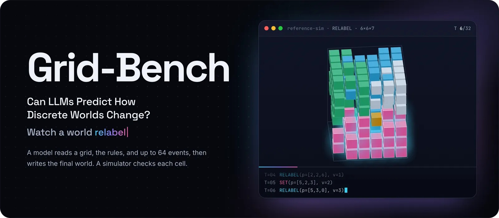
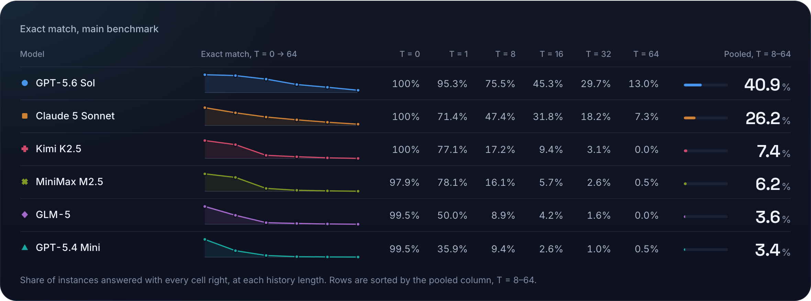
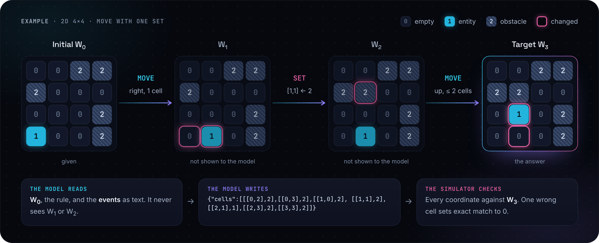
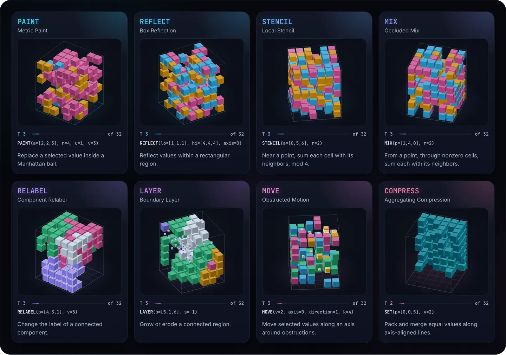
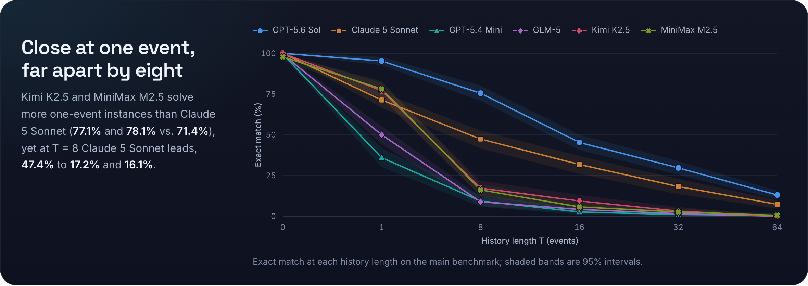

<p align="center">
  
</p>

<p align="center">
  <a href="https://arxiv.org/abs/2610.22312"></a>
  <a href="https://grid-bench.github.io/"></a>
  <a href="https://huggingface.co/datasets/xzx34/Grid-Bench"></a>
  <a href="https://github.com/grid-bench/Grid-Bench/actions/workflows/ci.yml"></a>
  
  <a href="LICENSE"></a>
  <a href="LICENSE-DATA"></a>
</p>

<p align="center">
  <a href="#leaderboard">Leaderboard</a> ·
  <a href="#the-task">The task</a> ·
  <a href="#findings">Findings</a> ·
  <a href="#quickstart">Quickstart</a> ·
  <a href="#evaluate-your-model">Evaluate your model</a> ·
  <a href="#data">Data</a> ·
  <a href="#citation">Citation</a>
</p>

Grid-Bench evaluates spatial state prediction under explicit rules. Each
instance supplies an initial grid and an ordered sequence of spatial operations
as text. The model returns the complete final grid in one response, and an
executable simulator checks every predicted value.

Eight operation families cover geometry, neighborhoods, connected regions, and
movement in two-, three-, and four-dimensional grids. The accompanying study
contains **1,488 instances from 248 trajectories** and **8,928 evaluation
records across six models**.

## News

- **2026-10-15** — The paper is on [arXiv](https://arxiv.org/abs/2610.22312).
- **2026-10-14** — Grid-Bench 0.6.0: the code, the
  [dataset](https://huggingface.co/datasets/xzx34/Grid-Bench), and the
  [website](https://grid-bench.github.io/) are public.

## Leaderboard

<p align="center">
  
</p>

Six LLMs answer the same prompts, once each and without tools. A grid counts
only if every cell is right. T is the number of events in the history; the main
benchmark has 192 instances at each length. Rows are sorted by exact match pooled
over T = 8–64. The [website](https://grid-bench.github.io/#leaderboard) breaks
the scores down by operation, dimension, and workload.

<details>
<summary>Leaderboard as a table</summary>

| Model | T = 0 | T = 1 | T = 8 | T = 16 | T = 32 | T = 64 | Pooled, T = 8–64 |
| --- | ---: | ---: | ---: | ---: | ---: | ---: | ---: |
| GPT-5.6 Sol | 100% | 95.3% | 75.5% | 45.3% | 29.7% | 13.0% | **40.9%** |
| Claude 5 Sonnet | 100% | 71.4% | 47.4% | 31.8% | 18.2% | 7.3% | **26.2%** |
| Kimi K2.5 | 100% | 77.1% | 17.2% | 9.4% | 3.1% | 0.0% | **7.4%** |
| MiniMax M2.5 | 97.9% | 78.1% | 16.1% | 5.7% | 2.6% | 0.5% | **6.2%** |
| GLM-5 | 99.5% | 50.0% | 8.9% | 4.2% | 1.6% | 0.0% | **3.6%** |
| GPT-5.4 Mini | 99.5% | 35.9% | 9.4% | 2.6% | 1.0% | 0.5% | **3.4%** |

Empty, invalid, and length-terminated outputs count as wrong.

</details>

## The task

<p align="center">
  
</p>

The example follows the paper's Figure 1; it is not a benchmark instance.
Histories hold 0, 1, 8, 16, 32, or 64 events. Each prefix of a trajectory is a
separate instance, so one world is tested at six lengths. Main-benchmark worlds
are 16×16, 6×6×7, or 4×4×4×4.

Each history uses one operation family, with optional single-cell SET events:

<p align="center">
  
</p>

The [task definitions](docs/tasks.md) specify every transition.

## Findings

<p align="center">
  
</p>

- **Longer histories, lower scores.** For all six models, exact match falls at
  every step from T = 0 to T = 64. The best model, GPT-5.6 Sol, gets 95.3% of
  grids exactly right after one event and 13.0% after 64.
- **Close at one event, far apart by eight.** Kimi K2.5 and MiniMax M2.5 solve
  more one-event instances than Claude 5 Sonnet (77.1% and 78.1% vs. 71.4%),
  yet at T = 8 Claude 5 Sonnet leads, 47.4% to 17.2% and 16.1%.
- **Similar scores, different errors.** Kimi K2.5 and MiniMax M2.5 are nearly
  tied at T = 8, yet where both return a valid wrong grid, the median wrong grid
  misses 5.5% of cells for Kimi K2.5 and 26.2% for MiniMax M2.5.
- **Wrong grids can still capture real change.** At T = 64 the six models miss
  the exact grid on 96.4% of their attempts, yet GPT-5.6 Sol's valid answers
  still get 81.6% of cells right, against 51.0% for copying the initial world.

## Quickstart

Requires Python 3.11 or newer. Install from a clone of this repository:

```sh
git clone https://github.com/grid-bench/Grid-Bench.git
cd Grid-Bench
python -m pip install -e .
python scripts/quickstart.py
```

The quickstart runs a small example and scores the reference answer and a
copy-initial baseline. It needs no credentials or model calls. The simulator,
generator, prompt renderer, and scorer use only the Python standard library.

```sh
grid-bench render-prompt examples/metric_paint.json
grid-bench simulate examples/metric_paint.json
```

The Python package is `grid_bench`; the command-line tool is `grid-bench`.

## Evaluate your model

Obtain the companion data directory using the [data guide](docs/data.md#get-the-data),
then send each row's `prompt` to your model. Save
one JSONL record per response:

```json
{"public_id":"<the instance's public_id>","response":"<the model's returned text>"}
```

Then score the answers directly:

```sh
grid-bench evaluate \
  --data /path/to/Grid-Bench-data \
  --predictions answers.jsonl \
  --out evaluation
```

The default `main` view includes 1,152 instances. Use `--view workload` for
within-family workload comparisons or `--view all` for all 1,488 instances.
These views overlap; use `main` for comparisons with the main study.
The evaluator writes summary metrics and per-instance scores, counting missing
answers in the selected denominator. See the [evaluation guide](docs/evaluation.md)
for the Python API, answer contract, and metrics.

## Generate and extend tasks

```sh
grid-bench generate --config examples/quickstart-config.json \
  --out /tmp/grid-bench-demo
```

The [generation guide](docs/generation.md) explains configuration and how to add
an operation family. The [format reference](docs/formats.md) documents instances,
answers, and reference records.

## Reproduce the study summaries

```sh
python -m pip install -e '.[plots]'
python scripts/reproduce_release.py \
  --data /path/to/Grid-Bench-data \
  --out /tmp/grid-bench-reproduced
```

This offline workflow verifies prompts and reference states, reconstructs six
result tables, and plots accuracy by history length. It uses released
measurements; collected model answers are not distributed. See the
[reproduction guide](docs/reproduction.md) for the checks and outputs.

## Data

The [Hugging Face dataset](https://huggingface.co/datasets/xzx34/Grid-Bench) has
two configurations, each with one `test` split:

| Configuration | Rows | Contents |
| --- | ---: | --- |
| `benchmark` | 1,488 | Instances, exact prompts, and simulator references |
| `results` | 8,928 | Recorded evaluation measurements for six models |

```python
from datasets import load_dataset

benchmark = load_dataset("xzx34/Grid-Bench", "benchmark", split="test")
```

The [dataset guide](docs/data.md) describes views, sample units, and provenance.
The results contain measurements only; collected model answers, predicted grids,
and answer-bearing cases are not distributed.

## Citation

[CITATION.cff](CITATION.cff) contains the paper citation and software metadata.
To cite the benchmark:

```bibtex
@misc{xu2026gridbench,
  title = {Grid-Bench: Can {LLMs} Predict How Discrete Worlds Change?},
  author = {Xu, Zixiang and Song, Zirui and Zheng, Wanrong and Zhang, Chiyu and Huang, Yue and Peng, Yuyang and Zhang, Kexin and Chen, Jinkun and Chen, Xiuying and Zhang, Xiangliang and Liu, Yan and Itti, Laurent and Shyu, Frank and Luo, Xiaoqiang and Pandey, Sandeep and Liu, Xi and Simon, Luke and Hu, Xiyang and Zhao, Yue},
  year = {2026},
  eprint = {2610.22312},
  archivePrefix = {arXiv},
  primaryClass = {cs.CL},
  doi = {10.48550/arXiv.2610.22312},
  url = {https://arxiv.org/abs/2610.22312}
}
```

## License

Code is licensed under [MIT](LICENSE); original benchmark data use
[CC BY 4.0](LICENSE-DATA). See [licensing and release scope](LICENSE_STATUS.md).
Maintainer: Zixiang Xu ([xzx34](https://github.com/xzx34)).

## Development

```sh
python -m pip install -e '.[dev,plots]'
pytest
ruff check src tests scripts examples
pyright
```

The repository maintains the implementation directly in `src/grid_bench/`,
with self-contained tests in `tests/`. See [CONTRIBUTING.md](CONTRIBUTING.md)
for changes to rules, scoring, and data, and [CHANGELOG.md](CHANGELOG.md) for
release notes.
